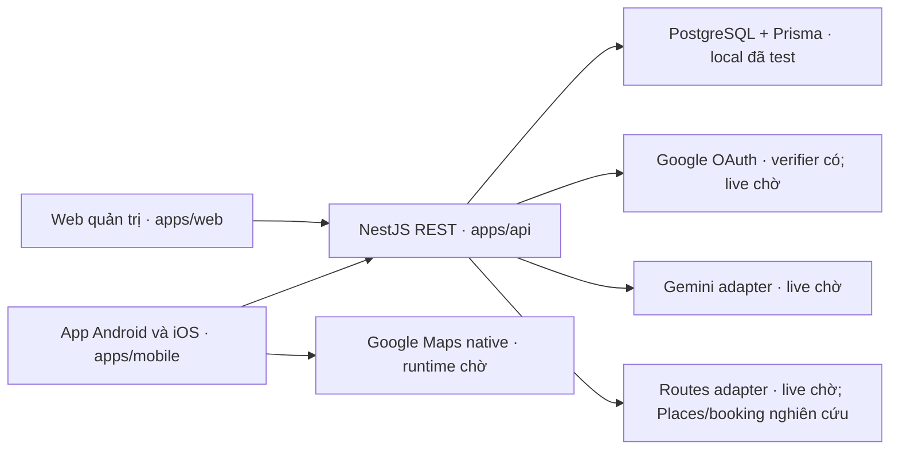

# Kiến trúc nền và hướng phát triển

## Cấu trúc hiện tại và dự kiến

Workspace kế thừa PR #12/#17, đã bổ sung mobile Expo, PostgreSQL/Prisma, auth/session/quyền server, API chuyến, shell admin và adapter Gemini/Maps. Sơ đồ mô tả code hiện có cùng dịch vụ phụ thuộc; Google live, iOS native, preview/staging chưa đạt. Luồng chuyến app còn ở #6; xem receipt từng phần thay vì suy nghiệm thu từ cây code.

Cây code đang có (không tạo thư mục dự kiến rỗng):

```text
apps/api/src/           # bootstrap/config, health, database, modules/auth/ai/trips/maps/admin
apps/api/prisma/        # schema và migration; seed/operator ở backend
apps/api/test/          # HTTP/config/env và PostgreSQL integration
apps/web/src/           # admin shell/pages, catalog/auth client, components/ui, lib, test
apps/mobile/            # App.tsx; src/features/auth/maps, health; native config
packages/contracts/src/# type và runtime guard giao tiếp
scripts/               # kiểm tra AST dependency
tests/                 # architecture, dependency, smoke, dev regression
docs/                  # scope, workflow, kiến trúc và kiểm chứng
```



App khách Android và iOS phát triển **song song ngay từ đầu** bằng **một codebase React Native + TypeScript + Expo**. Development build cho dev/kiểm chứng; preview nội bộ cho nghiệm thu cuối phải có JS/assets, mở khi Metro tắt và gọi HTTPS staging trên thiết bị thật từng nền tảng. Ưu tiên thư viện hỗ trợ cả hai, kiểm chứng tương thích trước khi chọn ở #15/#8; chỉ tách phần đặc thù khi cần, không làm xong Android rồi mới iOS. `apps/web` giữ React + Vite + TypeScript, Tailwind + shadcn/ui cho quản trị/vận hành. Chia sẻ API contracts/logic phù hợp, không hứa chung toàn bộ UI. Không đổi tên repo hoặc di chuyển `apps/web`.

## Phần đang chạy từ GE-M0-01

`apps/web` là React/Vite SPA: pages bố trí màn hình, components hiển thị, lib chứa fetch và tiện ích. Tailwind v4 dùng Vite plugin; Button từ shadcn/ui Radix new-york được điều chỉnh token GoEase. Shell admin theo baseline prototype review nội bộ #14/#16, chờ nyanduong nghiệm thu cuối. `/` và `/admin/catalog` là catalog có cổng phiên/quyền; `/admin/requests` ghi rõ phạm vi sau M0; `/technical/health` giữ kiểm tra kỹ thuật; URL lạ là 404. AuthProvider duy nhất chia sẻ AuthStore, không lưu role ở localStorage. Đổi identity/restore/logout ẩn dữ liệu và hủy request; backend kiểm tra quyền trên mỗi request.

`apps/api` là NestJS ESM trên Node 24, một backend REST chia theo chức năng, prefix `/api`, có health, auth/session/admin access và Maps HTTP. Bootstrap ConfigModule đọc `.env`/runtime và validate lúc khởi động; production bắt buộc WEB_ORIGINS hợp lệ. `createApp` nhận cấu hình explicit đã validate trong test, bỏ qua env file/runtime cá nhân. Filter chung trả `{ error: { code, message, statusCode }, path, timestamp }`; lỗi nội bộ không lộ stack/query. CORS dùng origin allowlist; khi auth cấu hình đủ, credentials và các method/header hợp lệ được bật theo [API](api/API.md). Web dùng cookie Secure/HttpOnly + Origin/CSRF; native dùng opaque bearer + SecureStore. Role hiện tại luôn do server xác minh.

AppModule production nối AuthModule, TripsModule, MapsModule, AdminModule. Trips giữ owner/CAS/idempotency theo [runbook](trips/README.md); catalog admin chỉ projection Place mẫu có nguồn, không join/count Trip/User/Session. HTTP test admin chỉ import AppModule thật để bắt lỗi thiếu wiring.

`packages/contracts` xuất type/error envelope và runtime guards health/auth/AI/Maps/Trips/admin, độc lập framework/DB/UI. Phản hồi `GET /api/health`:

```json
{"status":"ok","service":"goease-api","scope":"api-only","timestamp":"2026-10-08T08:00:00.000Z"}
```

Timestamp là thời điểm ISO UTC. Endpoint chỉ chứng minh tiến trình API trả lời, chưa phải readiness DB/AI/Maps. Web có timeout 8 giây, hủy request khi unmount, không tự gọi lại vô hạn; nút thử lại gửi request mới và bỏ success cũ khi thất bại. Timestamp hiển thị theo Asia/Ho_Chi_Minh.

`pnpm dev` build contracts trước rồi watch contracts/API/web; compiler lỗi giữ dist hợp lệ và phục hồi khi sửa. API dev dùng TypeScript watcher + Node watcher, web dùng Vite. Lệnh chạy riêng `dev:api`/`dev:web` cần contracts build hoặc watcher riêng; xem [README](../README.md), không chạy nhiều watcher contracts đồng thời.

Test hiện có: API/config và subprocess regression cô lập env, UI fetch doubles, smoke web production–API thật, dev fixture kiểm tra contracts/recovery/process cleanup. Chromium mobile là viewport web, không kiểm chứng native. Root typecheck/lint/test/build được chạy tuần tự trong **Quality Gate**; CI của PR mới phải kiểm chứng trên HEAD mới.

API local chỉ lắng nghe `127.0.0.1`; địa chỉ này trên điện thoại là điện thoại, chưa phải laptop. Bind/network trên thiết bị theo #15; public hosting/HTTPS/rollback theo #10. Localhost không được gọi là staging.

## Ranh giới sẽ triển khai theo issue

- **Dữ liệu và quyền:** PostgreSQL + Prisma chỉ API truy cập. Thiết kế dữ liệu/ma trận quyền ở [#2](https://github.com/nyanduong/go-ease-webapp/issues/2) đã review kỹ thuật nội bộ theo ủy quyền và merge trước migration [#3](https://github.com/nyanduong/go-ease-webapp/issues/3). Schema/migration/seed và grants hiện có được mô tả trong [DATA_MODEL](database/DATA_MODEL.md). Dữ liệu chuyến riêng tách khỏi danh mục tham chiếu admin quản lý. Backend xác minh danh tính/owner và cấp admin, không tin userId/ownerId/role từ app/web; biết URL hoặc ẩn menu không cấp/bảo vệ quyền. Admin không mặc nhiên được đọc/sửa mọi chuyến riêng.
- **Google OAuth:** #4 xác minh login/logout/session và quyền server; Android, iOS và web có client types/redirect/deep link phù hợp từng môi trường. Không sao chép giả định cookie/CORS web sang native; mock identity chỉ ở test, chưa phải login live.
- **AI:** Gemini adapter ở backend cho bản online, Ollama chỉ thử nghiệm, không gọi cả hai cho mọi yêu cầu. Dùng dữ liệu kiểm soát, validate input/output có cấu trúc, tính lại ngày/tiền/ràng buộc; người dùng được sửa. Timeout/retry có giới hạn, secret không ra app/web. Model/version/quyền/hạn mức/chi phí kiểm chứng ở #7 lúc triển khai; M0 chỉ spike tích hợp, chưa engine toàn MVP.
- **Maps:** khách xem map native trong app. #8/#15 kiểm chứng SDK/Expo development build trên Android/iOS trước chọn; Maps JavaScript/WebView/browser responsive không chứng minh native. Phân biệt bản đồ nền, dữ liệu Places (New) và tuyến Routes, SDK hiện dùng react-native-maps/Google provider cả hai nền tảng và expo-location foreground; Routes qua backend, Places chưa gọi. Lựa chọn vẫn cần build/runtime/key restrictions từng nền tảng theo [runbook](maps/README.md). Tọa độ/tuyến từ nguồn hợp lệ, không từ LLM bịa; quyền vị trí foreground, denied/revoked/no GPS/network/API/no route phải rõ. Tách key app Android/iOS và server, hạn chế/attribution/terms theo kết quả kiểm chứng.
- **Booking và staging:** đối tác khách sạn/vé máy bay vẫn thuộc MVP; #9 phân biệt quyền API/hợp đồng, sandbox, chuyển đối tác, yêu cầu và xác nhận, chưa giả định tồn chỗ/booking thật. #10 dùng HTTPS admin/API và DB riêng phía backend, bản thử Android/iPhone thật được ký/cài qua đường được phép; không tự tạo tài nguyên trả phí hoặc phát hành store.

MVP tại Việt Nam, một điểm đến chưa chốt, chuyến 1–5 ngày, ngân sách tổng nhóm VND và trải nghiệm địa phương. M0 kiểm chứng nền/tích hợp, chưa full AI/booking/admin suite; chưa turn-by-turn/giọng nói/vị trí nền/offline, tự vận hành vé/hoàn tiền, training AI, microservices hay hệ thống nhiều agent.

## Kiểm tra ranh giới tự động

Hướng import code: mỗi app chỉ dùng module của chính nó và `@goease/contracts`; contracts không import app, NestJS/Prisma/Node hoặc UI/framework. API sở hữu DB/auth/quyền và adapter Gemini/Places/Routes; client không import credential/server SDK/DB. Contracts giữ DTO/runtime validation giao tiếp; mọi payload ngoài cần validation runtime, type TypeScript không đủ. Module backend mở provider/API rõ, controller mỏng; không vòng import. Khi thêm `modules/`, Prisma hoặc routing mobile, cập nhật cây thực tế và fixture kiểm tra cùng PR; không tạo repository/mapper/interface rỗng hàng loạt. Expo Router chọn một cây `app/` hoặc `src/app/`, route mỏng, nghiệp vụ ở features; UI DOM/shadcn không dùng trong native.

`pnpm test:architecture` chạy [fixture hành vi](../tests/architecture/boundaries.test.ts) rồi [checker TypeScript AST](../scripts/check-architecture.ts) trên source thật. `pnpm test` gọi bước này trước các regression cũ; **Quality Gate** vẫn giữ typecheck/lint/test/build tuần tự. Checker:

- Đọc import, re-export, import type, `require()` và `import()` chuỗi cố định; chặn import động không thể phân tích tĩnh, gồm `import.meta.glob*` của Vite.
- Phân giải relative `.js` → source TypeScript, workspace package và alias `paths` trong tsconfig; import nội bộ chưa phân giải là lỗi. Chặn import giữa app, ra file ngoài workspace, production import test/fixture; contracts chỉ phụ thuộc code contracts.
- Chặn Node builtin cả `node:fs` và `fs/promises`, các package server/DB đã liệt kê ở client/contracts, framework UI trong contracts, UI DOM ở mobile và UI native ở web; kiểm tra cả tên import và package đích alias đã phân giải. Test/config của công cụ được tách khỏi code sản phẩm, không phụ thuộc tên thư mục cha của checkout.
- Theo graph local để phát hiện vòng import, kể cả re-export/import type/import động tĩnh; trả exit 1 với file/dòng khi có vi phạm. Riêng component vòng nằm hoàn toàn trong output Prisma `apps/api/src/generated/prisma/` được phép vì generator tạo vòng kiểu/model. Mọi import trong output vẫn được quét ranh giới; vòng có bất kỳ source viết tay nào vẫn bị chặn. Fixture âm kiểm tra cả lỗi và exit code CLI.

Source roots hiện là `apps/api/src`, `apps/web/src`, `packages/contracts/src`, `apps/mobile/src` và `apps/mobile/App.tsx`; checker cũng tự nhận route/entry mobile khác khi có. File local được import tiếp tục được quét; không quét `node_modules`/dist, test/spec, thư mục test hoặc cấu hình build ở root app. Đây là guard ban đầu, không phân tích code bên trong dependency npm hay chứng minh bundle không có secret: dependency/SDK mới cần review, mở rộng danh sách/fixture nếu cần, scanner và kiểm chứng runtime vẫn bắt buộc.

## Kiểm chứng và bàn giao

Android/iOS đã quyết định song song; Android local toolchain/build/emulator health đã xác minh ở #15. Preview/signing/thiết bị thật và iOS native còn chờ; trạng thái cụ thể ở [READINESS](verification/READINESS.md). #15 kiểm tra cả hai ngay khi dựng nền; prototype/OAuth/Gemini/Maps/staging/booking theo [bảng điều kiện](WORKFLOW.md#điều-kiện-cần-xác-minh). Kết quả riêng từng nền tảng dùng [mẫu nghiệm thu](WORKFLOW.md#mẫu-nghiệm-thu), phân biệt máy thật/emulator/simulator, Expo Go/development build và mock/sandbox/live; thiếu chỉ chặn phần tương ứng, không loại iOS hoặc tự báo đạt. Không cần key/thiết bị cho PR tài liệu.

Theo [WORKFLOW](WORKFLOW.md), đợt M0 được ủy quyền ngày **11/10/2026**: issue → branch → triển khai → test/review nội bộ → PR/Quality Gate HEAD → điều phối merge bằng browser → xác minh main/board. Required approvals = **0**, không cần collaborator hoặc xin xác nhận từng PR. Thiết kế/prototype là baseline nội bộ; **nyanduong nghiệm thu sản phẩm cuối ở #11**, #11 dùng `Refs` và giữ mở, milestone M0 vẫn mở. Không ghi leader đã duyệt hoặc native/live đã đạt khi thiếu bằng chứng. PR/Quality Gate/resolve trao đổi và bảo vệ main vẫn bắt buộc.
