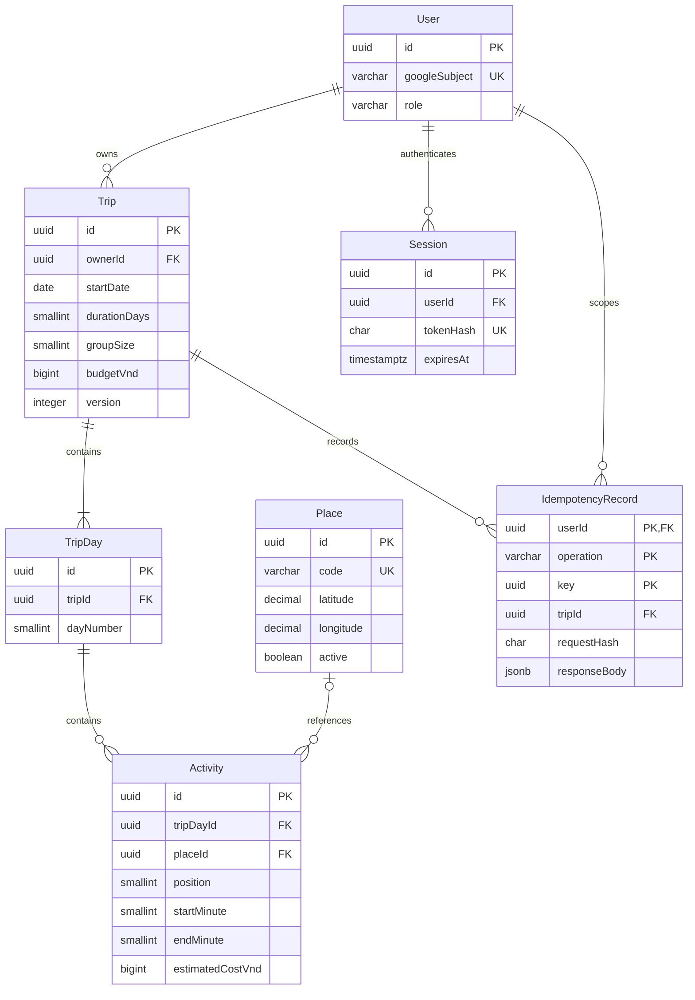

# Thiết kế dữ liệu M0

Baseline cho [#2](https://github.com/nyanduong/go-ease-webapp/issues/2), ngày 11/10/2026. Đây là **thiết kế để review nội bộ theo ủy quyền M0**, chưa phải schema đã chạy hoặc nyanduong đã nghiệm thu. [#3](https://github.com/nyanduong/go-ease-webapp/issues/3) chỉ viết migration sau khi baseline này đã review và merge; #4 triển khai auth, #5 triển khai API chuyến. Bằng chứng và ca review ở [GE-M0-02](../verification/GE-M0-02.md). Phạm vi sản phẩm theo [MVP_SCOPE](../MVP_SCOPE.md).

## Thực thể và ownership



Năm thực thể nghiệp vụ là User, Trip, TripDay, Activity, Place. Session và IdempotencyRecord chỉ hỗ trợ phiên thu hồi được và retry bền vững; không thêm booking, payment, collaboration hoặc AI conversation trong M0. UUID do server sinh, JSON là chuỗi UUID. `?` trong bảng là nullable; các field còn lại `NOT NULL`. Tên field là baseline logic, tên bảng/cột SQL và Prisma mapping được #3 chốt nhất quán.

### User — danh tính và quyền do server cấp

| Field | PostgreSQL / quy tắc |
| --- | --- |
| id | `uuid`, PK |
| googleSubject | `varchar(255)`, UNIQUE, chuỗi ASCII có phân biệt hoa thường, không rỗng; lấy từ `sub` của ID token **đã xác minh** |
| displayName? | `varchar(120)`, chỉ để hiển thị, không dùng xác định quyền |
| role | `varchar(16)`, CHECK `CUSTOMER` hoặc `ADMIN`, default `CUSTOMER` |
| disabledAt? | `timestamptz(3)`, tài khoản bị vô hiệu không tạo/dùng phiên |
| createdAt, updatedAt | `timestamptz(3)`, server/DB quản lý |

M0 chỉ có Google identity: normalize issuer hợp lệ về Google và UNIQUE `googleSubject` là đủ, không dùng email làm khóa hoặc tự liên kết bằng email. Google xác định `sub` ổn định kể cả khi email thay đổi; #4 kiểm tra chữ ký, issuer, audience, expiry và nonce/luồng phù hợp trước lookup/upsert. [Nguồn Google OIDC](https://developers.google.com/identity/openid-connect/openid-connect).

Không có API tự chọn role. Operator được phép cấp/thu hồi admin bằng thao tác server riêng với **subject đã xác minh**, ghi receipt an toàn; không cấp cho người đăng nhập đầu tiên hoặc domain/email client tự khai. Runtime DB role không có quyền ghi `User.role`/`disabledAt`; migration/provisioning dùng quyền riêng. Thay role phải có hiệu lực ở request kế tiếp, không tin role cũ trong cache/token. Không đưa subject thật, token hoặc tài khoản riêng vào seed/tài liệu public.

### Trip — aggregate riêng của một người

| Field | PostgreSQL / quy tắc |
| --- | --- |
| id | `uuid`, PK |
| ownerId | `uuid`, FK User, không đổi chủ trong M0; server lấy từ phiên |
| title | `varchar(160)`, trim, CHECK độ dài 1–160 |
| destinationCode | `varchar(64)`, mã bộ dữ liệu điểm đến đã kiểm soát, không phải market launch được nhóm duyệt |
| isSample | `boolean`, server đặt cho chuyến mẫu; UI hiển thị nhãn dữ liệu thử |
| startDate | `date`, trong 2000-01-01…2099-12-31; ngày cuối cũng trong khoảng này |
| durationDays | `smallint`, CHECK 1–5; ngày cuối tính `startDate + durationDays - 1` |
| timeZone | `varchar(32)`, CHECK bằng `Asia/Ho_Chi_Minh` trong M0 |
| groupSize | `smallint`, CHECK 1–50; giới hạn kỹ thuật M0, không phải số ghế/tồn chỗ |
| budgetVnd? | `bigint`, ngân sách **tổng nhóm**; CHECK null hoặc 0…1,000,000,000,000 |
| version | `integer`, default 1, CHECK 1…2,147,483,647; mỗi mutation thành công tăng đúng 1 |
| createdAt, updatedAt | `timestamptz(3)`, server/DB quản lý |

Index `(ownerId, updatedAt DESC, id)` phục vụ danh sách riêng, phân trang ổn định bằng cả timestamp và id. UNIQUE `(id, ownerId)` để FK của IdempotencyRecord không trỏ kết quả sang owner khác. M0 không có chuyển chủ, chia sẻ chuyến, API xóa chuyến hoặc thay ngày/độ dài sau tạo; sửa title/groupSize/budget/activities vẫn thuộc #5. Thay ngày ở tương lai phải chỉnh cả aggregate trong một transaction và giữ các invariant dưới đây.

### TripDay — thứ tự ngày trong chuyến

| Field | PostgreSQL / quy tắc |
| --- | --- |
| id | `uuid`, PK |
| tripId | `uuid`, FK Trip, không chuyển sang chuyến khác |
| dayNumber | `smallint`, CHECK 1–5, UNIQUE `(tripId, dayNumber)` |

Không lưu thêm `date` hoặc `ownerId`: ngày business luôn được **suy ra** bằng `Trip.startDate + dayNumber - 1`, quyền theo Trip. Mỗi chuyến có đủ dãy 1…durationDays, không lỗ hoặc thừa ngày; ngày trống activities hợp lệ. API trả `date: "YYYY-MM-DD"` đã tính. UNIQUE đồng thời là index truy vấn các ngày của chuyến.

### Activity — bản chỉnh của người quản lý chuyến

| Field | PostgreSQL / quy tắc |
| --- | --- |
| id | `uuid`, PK |
| tripDayId | `uuid`, FK TripDay; quyền đi qua TripDay → Trip |
| placeId? | `uuid`, FK Place; null cho hoạt động tự nhập chưa gắn map |
| position | `smallint`, CHECK 0–49, UNIQUE `(tripDayId, position)`; tối đa 50 hoạt động/ngày |
| title | `varchar(160)`, trim, CHECK độ dài 1–160; bản riêng, không đổi khi admin đổi tên Place |
| notes? | `varchar(1000)`, văn bản thuần, render có escape |
| startMinute?, endMinute? | `smallint`, CHECK `(startMinute IS NULL AND endMinute IS NULL) OR (startMinute IS NOT NULL AND endMinute IS NOT NULL AND 0 <= startMinute AND startMinute < endMinute AND endMinute <= 1440)` |
| estimatedCostVnd? | `bigint`, ước tính **tổng nhóm** cho hoạt động; cùng giới hạn tiền của Trip |

Index `placeId` cho FK và xác định nơi đang được tham chiếu. Thứ tự position không cần kín, API chuẩn hóa thành 0…n-1 khi lưu. Khi đổi thứ tự, service có thể xóa rồi insert lại tập Activity trong transaction, giữ ID hợp lệ của các hoạt động cũ; không swap từng row gây unique conflict tạm thời. M0 chưa có entity tham chiếu Activity nên cách này không làm hỏng FK con. Trùng giờ được giữ và có thể cảnh báo, chưa tự tối ưu lịch trình. Qua nửa đêm phải tách thành hai hoạt động/ngày; endMinute=1440 chỉ nghĩa là hết ngày đó. Title/notes/cost là dữ liệu chuyến riêng, không phải giá/availability/booking đã xác nhận của đối tác.

### Place — danh mục tham chiếu có nguồn

| Field | PostgreSQL / quy tắc |
| --- | --- |
| id | `uuid`, PK |
| code | `varchar(64)`, UNIQUE, khóa seed ổn định để upsert |
| destinationCode | `varchar(64)`, mã cùng bộ dữ liệu với chuyến mẫu |
| name | `varchar(160)`, trim, độ dài 1–160 |
| latitude, longitude | `numeric(9,6)`, CHECK lần lượt [-90,90], [-180,180]; chuyển JSON number ở mapper |
| sourceUrl | `varchar(2048)`, URL nguồn công khai đã kiểm tra, không chứa credential |
| attribution | `varchar(1000)`, ghi nguồn/quyền dùng cần hiển thị |
| isSample, active | `boolean`, nhãn dữ liệu thử và khả năng dùng cho lựa chọn mới |
| createdAt, updatedAt | `timestamptz(3)`, server/DB quản lý |

Index `(destinationCode, active, code)` cho catalog. M0 seed chỉ dữ liệu có quyền lưu/sử dụng đã xác định ở #3; không mặc định cache nội dung Places/Routes hoặc toàn bộ payload provider. #8 phải review điều khoản, attribution, thời hạn lưu trước khi thêm dữ liệu provider. Không dùng tọa độ do LLM bịa. Hoạt động mới chỉ chọn Place active và cùng destinationCode (service validate trong transaction); chủ chuyến vẫn đọc được Place inactive đang được tham chiếu. Admin deactivate thay vì xóa, không cascade dữ liệu riêng. Sửa catalog không cấp quyền đọc các chuyến tham chiếu nó.

## Ràng buộc DB và transaction

PostgreSQL CHECK kiểm tra trên từng row; không dùng hàm CHECK âm thầm đọc bảng khác để giả bảo đảm quan hệ. UNIQUE/FK đảm bảo tham chiếu; constraint trigger dùng cho cardinality liên bảng. [PostgreSQL constraints](https://www.postgresql.org/docs/current/ddl-constraints.html).

| Invariant | Cách enforce ở #3/#5 |
| --- | --- |
| Owner/parent/place tồn tại | FK thật; không chỉ kiểm tra trong TypeScript |
| Owner Trip và parent TripDay không bị đổi | Trigger `BEFORE UPDATE` từ chối đổi ownerId hoặc TripDay.tripId; API cũng không nhận field này |
| 1–5 ngày, số người, tiền, giờ, position, chuỗi, tọa độ | NOT NULL/CHECK/UNIQUE như các bảng trên; API runtime validate trước DB |
| Đủ đúng dãy ngày 1…durationDays | `AFTER ROW` constraint trigger **DEFERRABLE INITIALLY DEFERRED** trên Trip insert/update và TripDay insert/update/delete; khi commit, nếu Trip còn tồn tại thì count=durationDays, min=1, max=durationDays (cộng UNIQUE) |
| Serialize việc thay tập ngày | Trigger `BEFORE` thay TripDay khóa Trip tương ứng `FOR UPDATE` trước thay đổi; service cũng khóa parent trước. Transaction dùng READ COMMITTED; khóa theo thứ tự UUID nếu thao tác nhiều chuyến. Test hai connection thật |
| Atomic create/update | Trip + mọi TripDay/Activity + IdempotencyRecord cùng transaction; lỗi bất kỳ rollback toàn bộ |
| Không ghi đè phiên bản mới | Atomic compare-and-set `UPDATE Trip ... WHERE id=:id AND ownerId=:actor AND version=:expectedVersion`, tăng version rồi mới ghi children trong cùng transaction; affected rows phải là 1 |

Deferred check cần thiết vì Trip được insert trước các TripDay; check ngay sau từng statement sẽ cấm create hợp lệ. Xóa parent qua thao tác được phép ở tương lai thì trigger bỏ qua Trip không còn tồn tại. Không bỏ trigger để seed. Ngày được suy ra nên không thể tồn tại field ngày lệch parent. Trigger/SQL bổ sung phải nằm trong migration đã version hóa; Prisma schema không biểu diễn đủ mọi CHECK/trigger. [CREATE TRIGGER](https://www.postgresql.org/docs/current/sql-createtrigger.html), [Prisma migration cho DB feature bổ sung](https://www.prisma.io/docs/orm/prisma-migrate/workflows/unsupported-database-features).

FK delete policy: User → Trip `RESTRICT`; User → Session `CASCADE`; Trip → TripDay → Activity `CASCADE`; Place → Activity `RESTRICT`; User/Trip → IdempotencyRecord `RESTRICT`. Không có delete endpoint M0. Xóa tài khoản/dữ liệu về sau phải có quy trình retention và xử lý idempotency riêng, không thêm soft-delete toàn bộ bảng ngay bây giờ.

Runtime DB role chỉ dùng phía API, không có DDL, không provision admin; connection migration/operator tách riêng. Không áp dụng RLS trong baseline M0: ownership của caller được enforce tại service/repository có query scope và test A/B, không suy rằng FK tự xác minh người đang gọi. Không log SQL bind chứa dữ liệu riêng hoặc connection string.

## Ngày, giờ, tiền qua PostgreSQL → JSON → app

`startDate` và ngày suy ra là **ngày lịch Việt Nam**, không phải instant. API chỉ nhận/trả `YYYY-MM-DD`, parse lịch thật (năm nhuận/ngày tồn tại), không nhận ISO timestamp thay ngày. Không dùng `new Date(dateString).toLocaleDateString()` theo timezone thiết bị để render ngày business. Mapper Prisma `@db.Date` phải lấy thành phần UTC thành chuỗi date; arithmetic theo ngày lịch/SQL `date + integer`, không cộng mili giây rồi đổi zone.

Giờ hoạt động truyền số phút nguyên từ đầu ngày; UI format trực tiếp HH:mm, gồm 1440 → `24:00`, không serialize qua Date/UTC. Timestamp kỹ thuật dùng `timestamptz(3)`, trả ISO 8601 UTC có `Z`; hiển thị timestamp có thể theo locale, không làm đổi ngày/giờ lịch trình. Phân biệt date với timestamp theo [PostgreSQL date/time](https://www.postgresql.org/docs/current/datatype-datetime.html).

VND không có phần lẻ trong M0: DB bigint, mapper nội bộ BigInt, JSON number **nguyên hữu hạn**, từng khoản 0…10^12, không truyền JS BigInt trực tiếp vào JSON. Validate `Number.isSafeInteger`, không parseFloat/round tiền để cứu payload sai; chuỗi `"1000000"`, số âm, 1.5 và >10^12 bị từ chối. Với 5×50 hoạt động, tổng đã biết tối đa 250×10^12 = 250,000,000,000,000, vẫn nhỏ hơn 9,007,199,254,740,991; server cộng bằng BigInt rồi kiểm tra trước chuyển number.

`null` là **chưa biết**, 0 là **biết bằng không**. API trả `knownSubtotalVnd`, `unknownCostCount` và `estimatedTotalVnd` (null nếu còn hoạt động chưa biết chi phí); danh sách rỗng cho subtotal/total 0. Không hiển thị tổng đã biết như tổng hoàn chỉnh. Không chia ngân sách theo người/ngày hoặc nhân tiền với groupSize lần nữa. Vượt budget có thể cảnh báo, không biến ngân sách thành giá booking hay tự cấm lưu.

## Ma trận quyền và phiên

| Thao tác | Ẩn danh/hết hạn/đã logout | Customer A | Customer B | Admin server cấp |
| --- | --- | --- | --- | --- |
| Đọc/cập nhật hồ sơ mình | 401 | Chỉ mình | Chỉ mình | Chỉ mình |
| Tạo/list chuyến | 401 | Owner luôn A, list A | Owner luôn B, list B | Chỉ các chuyến do chính admin sở hữu |
| Đọc/sửa Trip của A, children, replay kết quả A | 401 | Cho phép | 404 | 404 nếu không phải owner A |
| Đọc catalog active dùng tạo chuyến | 401 | Cho phép | Cho phép | Cho phép |
| Admin shell/endpoint catalog được cấp | 401 | 403 | 403 | Cho phép đúng endpoint được cấp |
| Tự đổi role/owner, đọc mọi chuyến, cấp admin qua API | Từ chối | Từ chối | Từ chối | Từ chối trong M0 |

Backend lấy actor từ Session đã xác minh, query `Trip.id AND Trip.ownerId`; child route phải join đến cùng Trip, không chỉ tìm Activity/TripDay bằng id. Trip không tồn tại và Trip của người khác cùng trả 404, không trả title/owner/version để dò dữ liệu. Reject field không thuộc writable DTO (`ownerId`, `userId`, `role`, timestamps, version do server cấp); `expectedVersion` là điều kiện ghi riêng. Admin guard và owner guard là hai quyết định riêng; không có nhánh `isAdmin || isOwner` cho chuyến riêng. Catalog/public report cho admin không chứa thống kê suy ra từ lịch trình cá nhân.

Session tối thiểu: `id uuid PK`, `userId uuid FK`, `tokenHash char(64) UNIQUE`, `createdAt timestamptz(3)`, `expiresAt timestamptz(3)` CHECK > createdAt, `revokedAt timestamptz(3)?`; index `(userId, expiresAt)`. Token ngẫu nhiên đủ entropy (ít nhất 32 byte), DB chỉ giữ SHA-256 của token; request lookup phiên chưa revoked/chưa expired, join User chưa disabled và role hiện tại. Logout revoke phiên, không xóa Trip. #4 chốt transport native secure storage và web HttpOnly cookie/CSRF phù hợp; không lưu token nhạy cảm trong AsyncStorage/localStorage, không thêm bypass staging hoặc token mẫu vào repo. Đây chưa phải login Google live đã chạy.

## Idempotency bền vững và update version

Create và update dùng header `Idempotency-Key` UUID do client sinh **một lần cho một thao tác lưu** và giữ nguyên khi retry trong phiên. Thiếu/sai key → 400. Scope do server tạo: `(userId, operation, key)`, trong đó operation là `trip.create` hoặc `trip.update:<tripId>`. Body/key đổi sau khi người dùng sửa nội dung là thao tác mới. Request đã gửi nhưng chưa biết kết quả phải được phục hồi trước khi gửi thao tác mới; không tự đổi key ở timeout. Không hứa draft chưa lưu sống qua OS kill.

IdempotencyRecord tối thiểu:

| Field | PostgreSQL / quy tắc |
| --- | --- |
| userId, operation, key | PK kép ba field; userId FK User, operation `varchar(64)`, key `uuid` |
| requestHash | `char(64)`, SHA-256 của operation + payload đã validate/normalize/canonicalize (gồm expectedVersion khi update); không hash raw JSON theo thứ tự key ngẫu nhiên |
| tripId | `uuid`, FK kép `(tripId, userId)` → Trip `(id, ownerId)` |
| statusCode | `smallint`, CHECK 200 hoặc 201 |
| responseBody | `jsonb`, snapshot phản hồi chuyến/phiên bản thành công; không token, role hoặc dữ liệu người khác |
| createdAt | `timestamptz(3)` |

Index `tripId` cho FK. M0 giữ record cùng dữ liệu chuyến, **không TTL xóa key rồi cho phép tạo trùng**. #5 giới hạn body 256 KiB và 50 activities/ngày, giới hạn request phù hợp; response snapshot không chứa provider payload. Retention quy mô lớn sau M0 phải giữ tombstone chống reuse hoặc protocol expiry rõ, không được âm thầm hạ guarantee retry. Hash không thay quyền truy cập hoặc validation.

Thuật toán không cần hàng pending hoặc lock phân tán:

1. Xác thực actor/quyền hiện tại, validate payload. Tìm record theo scope; cùng hash → trả status/body đã lưu, khác hash → 409 `IDEMPOTENCY_CONFLICT`, không mutate.
2. Nếu chưa có, chạy một transaction: tạo aggregate hoặc compare-and-set version trước sửa children; build response bằng dữ liệu DB; insert record **trong cùng transaction trước commit**. Chỉ gửi success sau commit. Lỗi validation/DB không ghi receipt thành công.
3. Hai create cùng key có thể cùng bắt đầu; UNIQUE record quyết định người thắng. Transaction thua rollback cả Trip/children; **bắt đúng unique conflict ở ngoài transaction**, dùng query mới đọc record đã commit, so hash và replay. Không query tiếp trong transaction PostgreSQL đã abort, không trả 500 chỉ vì race hợp lệ.
4. Update cùng key/expectedVersion: request thua compare-and-set phải rollback rồi tìm record bằng query mới trước khi trả stale-version; winner có thể đã ghi chính kết quả cần replay. Nếu không có record, 409 `VERSION_CONFLICT`, không ghi children. Hai key khác nhau cùng expectedVersion chỉ một ghi thành công. Serialization/deadlock có retry server hữu hạn; mọi retry giữ key và không gọi dịch vụ ngoài có side effect trong transaction.
5. Nếu process chết trước commit thì mọi thứ rollback; chết sau commit/mất response thì retry lấy receipt. Cùng key sau API restart vẫn trả cùng tripId/responseVersion, không tăng version lần nữa. Replay snapshot cũ không có nghĩa dữ liệu hiện tại chưa đổi: client GET lại cùng tripId để nhận canonical version trước edit tiếp, không tự ghi đè bằng snapshot cũ.

PUT/save dùng full editable aggregate + `expectedVersion` lấy từ GET gần nhất; IDs child có sẵn phải thuộc đúng chuyến, child mới server sinh id, không nhận id lạ để attach dữ liệu B. Sửa/reorder/xóa Activity trong cùng transaction; ngày và owner không writable ở M0. Khi version cạn hoặc stale phải từ chối rõ, không wrap về 0. Mất mạng giữ draft trong phiên và trạng thái “chưa xác nhận lưu”; saved chỉ sau response/replay thành công đã reconcile GET. Không tự retry conflict bằng expectedVersion mới vì sẽ đè chỉnh sửa của phiên khác.

## Payload minh họa và ca biên

Các UUID/mã dưới là ví dụ cấu trúc, không phải dữ liệu đã có trên staging hoặc tọa độ đã xác minh. #3 seed chọn một bộ điểm đến thử có nguồn và nhãn; #5 cập nhật API doc bằng id chạy thật. Ví dụ create 1 ngày, ngân sách tổng 4 người, chi phí chưa biết khác miễn phí:

```http
POST /api/trips
Idempotency-Key: 10000000-0000-4000-8000-000000000001
Content-Type: application/json
```

```json
{
  "title": "Chuyến mẫu của nhóm",
  "destinationCode": "vn-demo",
  "startDate": "2026-10-11",
  "durationDays": 1,
  "groupSize": 4,
  "budgetVnd": 2000000,
  "days": [{
    "dayNumber": 1,
    "activities": [
      {"title": "Đi bộ", "placeId": null, "position": 0, "notes": null, "startMinute": 540, "endMinute": 600, "estimatedCostVnd": 0},
      {"title": "Bữa trưa tự chọn", "placeId": null, "position": 1, "notes": null, "startMinute": null, "endMinute": null, "estimatedCostVnd": null}
    ]
  }]
}
```

Response thêm id server, version=1, timeZone=`Asia/Ho_Chi_Minh`, isSample theo nguồn create và ngày suy ra `2026-10-11`; `knownSubtotalVnd=0`, `unknownCostCount=1`, `estimatedTotalVnd=null`. owner không lấy từ body. Update thêm `expectedVersion: 1`, giữ các writable field và child IDs do GET trả; dùng key khác create. Tên endpoint là baseline cho #5, **hiện chưa triển khai**, không phải lời khẳng định OpenAPI đã có.

| Input/tình huống | Kết quả thiết kế |
| --- | --- |
| startDate=2026-12-29, durationDays=5 | Đạt; dãy 29/12…02/01/2027, ngày cuối tính inclusive |
| startDate=2028-02-28, durationDays=3 | Đạt; có 29/02; 2026-02-29 hoặc 2026-04-31 bị từ chối |
| durationDays=0/6/1.5; groupSize=0/51/2.5 | 400 trước DB; SQL insert sai cũng bị constraint từ chối |
| N=1 có dayNumber=2; N=5 thiếu ngày 3/trùng ngày 2 | Từ chối toàn aggregate; direct SQL commit cũng fail deferred/unique constraint |
| startDate=`2026-10-11T00:00:00Z` hoặc `infinity` | 400; chỉ chuỗi ngày lịch trong range |
| Đổi timezone điện thoại sang UTC-7 | Ngày 11/10 và startMinute=540 vẫn là 11/10 09:00 Việt Nam |
| startMinute=1410, endMinute=1440 | Đạt 23:30–24:00; end<start hoặc chỉ một field null bị từ chối |
| budgetVnd=null/0/10^12 | Đạt, ba ý nghĩa khác nhau; -1/0.1/10^12+1/chuỗi số bị từ chối |
| Chi phí đã biết 300000 và null | subtotal=300000, unknownCount=1, total=null; không báo tổng 300000 hoàn chỉnh |
| A gửi ownerId=B/role=ADMIN | 400 field lạ; không nâng quyền; A gọi Trip/Activity B → 404 |
| Admin gọi Trip A không thuộc mình | 404 dù admin endpoint catalog được phép |
| Cùng key, cùng nội dung, response lost/restart/concurrent | Một aggregate/mutation; cùng status/id/version được replay |
| Cùng key khác payload, gồm expectedVersion khác | 409 idempotency conflict; không đổi DB |
| Hai save version=1 với hai key | Một version=2 thành công; một 409, không partial children hoặc tự ghi đè |
| Place deactivate hoặc admin đổi tên | Chuyến đã lưu không bị xóa/đổi Activity.title; vẫn đọc tham chiếu theo quyền owner |

## Điểm bàn giao sang triển khai

[#3](https://github.com/nyanduong/go-ease-webapp/issues/3) thêm Prisma schema/migration/seed thật dưới `apps/api/prisma`, cập nhật link trực tiếp tại đây khi file tồn tại, kiểm chứng SQL constraints/trigger trên PostgreSQL thật (DB mới và nâng DB test có dữ liệu). **Chưa có migration/seed trong baseline #2**, không tạo link file giả. Seed idempotent bằng Place.code, không tạo admin mặc định, không reset DB/staging.

#4 kiểm chứng Session/auth và ma trận quyền; #5 kiểm chứng persistence, concurrent create/update, response lost, rollback và API/contract runtime; #6/#10/#11 kiểm chứng mở lại và mất mạng riêng Android/iOS. Không dùng test thiết kế, mock Prisma hoặc web viewport làm bằng chứng PostgreSQL/native/live. Booking sau M0 có thể tham chiếu Trip/User/Place nhưng cần entity và quyền riêng sau nghiên cứu #9; không suy đặt chỗ từ Activity.
