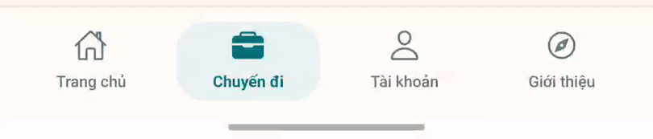

# GoEase · Phản hồi chạm · 17/10/2026

Phạm vi lần này chỉ gồm UI. Giữ nguyên API, xác thực, dữ liệu chuyến và các callback nghiệp vụ.

- Menu: nền chọn xanh nhạt kéo giãn bằng hai cạnh lò xo, thu về mục mới; biểu tượng được chọn chuyển sang dạng đặc. Bốn nhãn được giữ nguyên.
- Trang chủ / Chuyến đi đổi nội dung ngay. Tài khoản / Giới thiệu giữ cách mở trang và quay lại hiện tại; phản hồi menu chạy trước khi mở trang 180 ms. Lần nhấn tiếp theo trong thời gian chờ thay thế lần trước; chặn mở trang trùng khi đã bắt đầu điều hướng. Quay lại khôi phục đúng mục.
- Nút chính, nút biểu tượng, chọn ngày, tab lịch trình và tiêu đề mở rộng: thu nhẹ khi chạm, trở về bằng lò xo khi thả hoặc hủy cử chỉ. Thẻ chuyến chỉ thu 1% để hình ảnh và chữ ổn định.
- Mũi tên mở rộng xoay nhẹ; nội dung vẫn được giữ mounted để bảo toàn trạng thái đang nhập.
- Dùng Reanimated có sẵn, không thêm thư viện. Chuyển động tuân theo Reduce Motion của hệ thống; không đổi thiết lập điện thoại.

Đã kiểm tra UI trực tiếp trên Samsung S20 FE / Android 13: chuyển Trang chủ ↔ Chuyến đi nhiều lần, mở Giới thiệu và Tài khoản rồi quay lại. `menu.gif` được cắt từ video quay trên điện thoại, thể hiện quá trình co giãn thực tế. Đã xem bản web ở 320 × 740 và 390 × 844: nhãn menu không tràn hoặc xuống dòng; console không có lỗi.

Kiểm tra mã: mobile TypeScript và ESLint đạt; `git diff --check` đạt. Không chạy lại bộ test nghiệp vụ, đăng nhập, Gemini, bản đồ hoặc API; không kiểm thử iOS trong lần này. Cơ chế Reduce Motion được cài đặt trong mã, chưa đổi cài đặt hệ thống để thử trực tiếp.

Tham khảo chuyển động: [React Bits Rubber Segment](https://reactbits.dev/micro/rubber-segment). Tham khảo cách điều hướng và phản hồi ngắn gọn từ [Instagram / Meta](https://about.fb.com/news/2025/09/in-india-instagram-debuts-a-reels-first-experience-for-its-mobile-app/), [Meta Blueprint](https://www.naldi.me/work/meta-blueprint), [TikTok / Lynx](https://developers.tiktok.com/blog/lynx-opensource-introduction). Đây là nguồn tham khảo công khai, không phải xác nhận đã kiểm tra phiên bản mới nhất của ba app trên máy người dùng.

