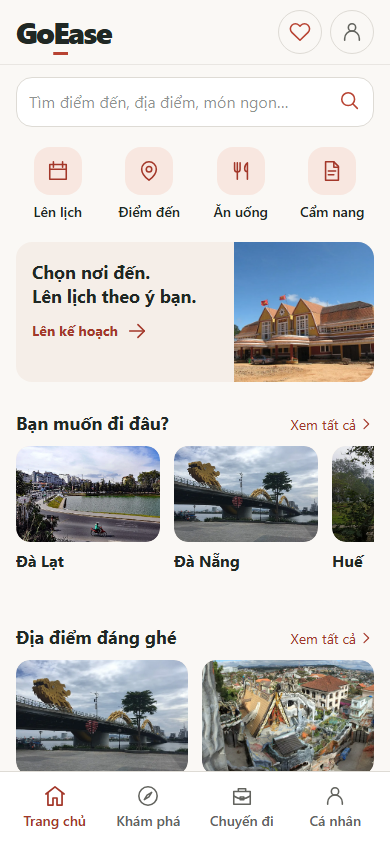

# GoEase V2 Core RC1 — UI completion / chờ nghiệm thu

Bản đã kiểm tra: `a28a380010cc60e538f137f0389e6cff4eb8223a`, tiếp tục từ `d97bfb1`. Mã giao diện chốt ở `8245d75`; hai commit sau chỉ sửa harness kiểm thử. Commit bàn giao bằng chứng không đổi mã chạy.

Mở ứng dụng đang chạy: http://localhost:5174/ — API http://localhost:3000/v1/health. Nhánh `nyan/goease-v2-discovery`, PR [#118](https://github.com/nyanduong/go-ease-webapp/pull/118), phụ thuộc [#117](https://github.com/nyanduong/go-ease-webapp/pull/117) → [#116](https://github.com/nyanduong/go-ease-webapp/pull/116). Không merge hoặc triển khai production. Tag RC1 cũ không di chuyển.

## Kết quả và giới hạn bằng chứng

| Phạm vi | Kết quả thật | Giới hạn |
| --- | --- | --- |
| Web | 69/69 ca trình duyệt; lint, typecheck, production build đạt | Identity/API/provider được mô phỏng trong suite này |
| Nest + Prisma + PostgreSQL | 24/24 ca trips, 6/6 ca CMS; UI tạo/sửa/lưu/reload/mở lại/bỏ yêu thích ở 360, 390, 1440px | DB riêng; Supabase identity fixture, đồng hồ auth fixture tách từng phiên; không đổi limiter production |
| Home/Khám phá/chi tiết | Chụp trực tiếp PWA và CMS/DB local thật, không mock, không ghi DB; tìm/lọc/Back/cuộn ngang/200% chữ đạt | Trình duyệt desktop mô phỏng viewport |
| Google thật | Phiên Google đang có mở được hồ sơ và khôi phục sau reload trong Chrome | Không logout tài khoản cá nhân để chạy OAuth mới; chưa xác nhận roundtrip OAuth mới ở lượt này |
| Dữ liệu cá nhân | 12/12 bảng có số dòng và SHA-256 giống trước/sau | Chỉ lưu hash, không đưa dữ liệu cá nhân/credential vào repo |
| Thiết bị và provider thật | Chưa kiểm chứng | Chưa thử bàn phím Android/iOS thật, SerpApi/Gemini/Google Maps live hoặc đồng bộ thiết bị thứ hai |

Log: [web](web-e2e.log), [DB](db-regression.log), [typecheck](typecheck.log), [lint](lint.log), [build](build.log), [docs](docs-check.log), [live UI](live-ui.log). Dữ liệu: [trước](db-before.json), [sau](db-after.json). [Evidence máy đọc](review.json), [live screenshots](verified/evidence.json), [request/status API thật](db-content/evidence.json).

## Thay đổi đã chốt

- Giữ bố cục Home/Khám phá đã duyệt. Bỏ biểu tượng “i” trên ảnh và khối nguồn dưới ảnh. Ghi công ảnh gom trong một mục “Thông tin ảnh” thu gọn cuối **cùng trang**, chỉ liệt kê ảnh đang hiển thị, theo đúng fallback; không cần mở sang trang khác. Giữ tác giả, nguồn, giấy phép và thông báo thu nhỏ/crop; không sửa metadata CMS hay manifest.
- Chi tiết bốn loại nội dung dùng header, kích thước chữ và khoảng cách thống nhất; bài viết có cột đọc riêng. CTA “Lên lịch tại [điểm đến]” phản ánh đúng việc chọn thành phố, không hứa tự thêm địa điểm.
- Quay lại từ chi tiết giữ trang xuất phát/từ khóa/bộ lọc. Ngữ cảnh này tồn tại sau hủy tạo chuyến và reload. Các guard Back, bản nháp cũ, thay đổi chưa lưu và phân tách tài khoản vẫn được kiểm thử.
- Chuyến đi: gọn bìa để hoạt động xuất hiện sớm, tên/điểm đến/ngày rõ; form thu gọn giải thích lưu tạm; giữ nhãn ngân sách cả nhóm, giá chưa rõ và miễn phí. Trạng thái lưu chỉ xác nhận sau phản hồi server.
- Hồ sơ, yêu thích, trợ giúp dùng cùng token/card/control. Giảm trang trí hồ sơ; giữ upload, Lưu/Hủy, lỗi lưu và các chức năng cũ. Không thay OAuth, thuật toán lịch hoặc backend.

### Nguồn và quyền ảnh

[Audit từng ảnh từ lượt trước](../v2-polish/photo-rights.json) vẫn áp dụng: tám ảnh đang dùng không đổi tệp/nguồn/giấy phép. Đã đối chiếu lại yêu cầu ghi công của [CC BY 4.0](https://creativecommons.org/licenses/by/4.0/) và [CC BY-SA 4.0](https://creativecommons.org/licenses/by-sa/4.0/). Vì các ảnh này cần ghi công, bỏ UI ghi công trên card không đồng nghĩa xóa thông tin đó. Mục cuối trang giữ ảnh/chủ thể, tác giả, liên kết nguồn/giấy phép và thông báo thay đổi; giấy phép của ảnh độc lập với ứng dụng. Ảnh public domain vẫn giữ thông tin nguồn. Không thay ảnh ngẫu nhiên.

## Home và Khám phá trước/sau

Các cặp dùng cùng viewport, zoom 100%, ảnh và dữ liệu đã tải. Trước: `d97bfb1`; sau: `a28a380`.

| Màn | 390×844 trước | 390×844 sau | 1440×1000 trước | 1440×1000 sau |
| --- | --- | --- | --- | --- |
| Home | [Ảnh](before/home-390.png) | [Ảnh](verified/home-390.png) | [Ảnh](before/home-desktop.png) | [Ảnh](verified/home-desktop.png) |
| Khám phá | [Ảnh](before/explore-390.png) | [Ảnh](verified/explore-390.png) | [Ảnh](before/explore-desktop.png) | [Ảnh](verified/explore-desktop.png) |

## Bộ ảnh theo hành trình

Ảnh public dùng CMS local thật. Các màn tài khoản/chuyến đi trong `journey` dùng identity và dữ liệu kiểm thử, không phải dữ liệu cá nhân. `db-content` chứng minh bổ sung các thao tác lưu bằng API/DB thật. Mỗi ảnh có liên kết thực trong repo, có thể xem qua PR/GitHub.

| Bước | 360px | 390×844 | Desktop 1440px |
| --- | --- | --- | --- |
| 1. Home | [Ảnh](verified/home-360.png) | [Ảnh](verified/home-390.png) | [Ảnh](verified/home-desktop.png) |
| 2. Khám phá | [Ảnh](verified/explore-360.png) | [Ảnh](verified/explore-390.png) | [Ảnh](verified/explore-desktop.png) |
| 3. Chi tiết địa điểm | [Ảnh](verified/detail-place-360.png) | [Ảnh](verified/detail-place-390.png) | [Ảnh](verified/detail-place-desktop.png) |
| 4. Danh sách trống | [Ảnh](journey/01-empty-360.png) | [Ảnh](journey/01-empty-390.png) | [Ảnh](journey/01-empty-1440.png) |
| 5. Tạo chuyến | [Ảnh](journey/02-create-360.png) | [Ảnh](journey/02-create-390.png) | [Ảnh](journey/02-create-1440.png) |
| 6. Xem trước (provider fixture) | [Ảnh](journey/preview-360.png) | [Ảnh](journey/preview-390.png) | [Ảnh](journey/preview-1440.png) |
| 7. Chỉnh lịch thủ công | [Ảnh](journey/03-edit-360.png) | [Ảnh](journey/03-edit-390.png) | [Ảnh](journey/03-edit-1440.png) |
| 8. Lưu và mở lại | [Ảnh](journey/04-reopened-360.png) | [Ảnh](journey/04-reopened-390.png) | [Ảnh](journey/04-reopened-1440.png) |
| 9. Chi phí chưa rõ | [Ảnh](journey/05-costs-unknown-360.png) | [Ảnh](journey/05-costs-unknown-390.png) | [Ảnh](journey/05-costs-unknown-1440.png) |
| 10. Bản đồ | [Ảnh](journey/06-map-360.png) | [Ảnh](journey/06-map-390.png) | [Ảnh](journey/06-map-1440.png) |
| 11. Danh sách đã lưu | [Ảnh](journey/07-list-360.png) | [Ảnh](journey/07-list-390.png) | [Ảnh](journey/07-list-1440.png) |
| 12. Cá nhân | [Ảnh](journey/08-account-360.png) | [Ảnh](journey/08-account-390.png) | [Ảnh](journey/08-account-1440.png) |
| 13. Sửa hồ sơ | [Ảnh](journey/09-profile-edit-360.png) | [Ảnh](journey/09-profile-edit-390.png) | [Ảnh](journey/09-profile-edit-1440.png) |
| 14. Trợ giúp | [Ảnh](journey/10-help-360.png) | [Ảnh](journey/10-help-390.png) | [Ảnh](journey/10-help-1440.png) |
| 15. Yêu thích qua API/DB thật | [Ảnh](db-content/360-favorites-reopened-real-db-auth-fixture.png) | [Ảnh](db-content/390-favorites-reopened-real-db-auth-fixture.png) | [Ảnh](db-content/1440-favorites-reopened-real-db-auth-fixture.png) |

Bổ sung: [chi tiết điểm đến](verified/detail-destination-390.png), [ẩm thực](verified/detail-food-390.png), [bài viết](verified/detail-article-390.png), [ghi công cuối trang](verified/attribution-390.png), [dialog mobile](journey/confirmation-form-mobile.png), [dialog desktop](journey/confirmation-form-desktop.png), [upload/hồ sơ fixture](journey/profile-mobile.png), [thiếu dữ liệu](journey/warm-refinement-missing-data.png), [sửa/lưu/reload qua DB thật](db-content/390-edited-saved-reloaded-real-db-auth-fixture.png).

## Checklist chỉ còn cần người dùng/thiết bị thật

1. Trên điện thoại thật, mở Home → Khám phá, tìm “Hằng Nga”, chọn Địa điểm, mở chi tiết → Lên lịch → Back. Mong đợi quay đúng chi tiết; Back tiếp giữ từ khóa/bộ lọc; vuốt các hàng ảnh không kéo tràn cả trang.
2. Tạo một chuyến cá nhân, nhập ngày/tên/ngân sách khi bàn phím đang mở. Chỉnh hoạt động → Lưu, chờ “Đã lưu vào tài khoản”, reload và mở lại từ Chuyến đi. Mong đợi không bị thanh điều hướng che nút; dữ liệu đúng sau mở lại và lưu lần hai.
3. Với tài khoản Google do bạn chọn: đăng xuất/đăng nhập mới, lưu một yêu thích và hồ sơ/ảnh; mở lại trên thiết bị thứ hai. Mong đợi đúng tài khoản, tên/ảnh/yêu thích/chuyến đã lưu đồng bộ; tài khoản khác không thấy dữ liệu đó. Không chia sẻ mật khẩu hay mã OTP cho agent.
4. Trên thiết bị thật, bật/tắt mạng trong khi đang sửa rồi kết nối lại. Mong đợi còn dữ liệu nhập, lỗi rõ, có thể thử lưu; không báo đã lưu khi chưa được xác nhận. Nếu muốn nghiệm thu provider live, cần thực hiện riêng với cấu hình/quyền provider hiện có; kết quả fixture ở đây không chứng minh provider live.

## Phần còn lại và điểm dừng

Không có lỗi chặn trong các ca đã kiểm chứng ở trên. Ảnh ẩm thực chợ đêm chưa đủ nguồn phù hợp vẫn hiển thị thiếu ảnh đúng ngữ cảnh; không tạo ảnh giả. Preview/provider live, kiểm tra thiết bị thật và OAuth mới có trạng thái chưa kiểm chứng như bảng. AI tài khoản, ưu đãi và mua gói không được triển khai trong lượt này. Các luồng lịch mẫu cũ không được dùng để lấp danh sách trống; không thêm dữ liệu mẫu vào DB cá nhân.

Dừng thay đổi thẩm mỹ tại bản này, chờ người dùng nghiệm thu Core. Đây không phải tuyên bố hoàn thành toàn bộ kế hoạch sản phẩm.
